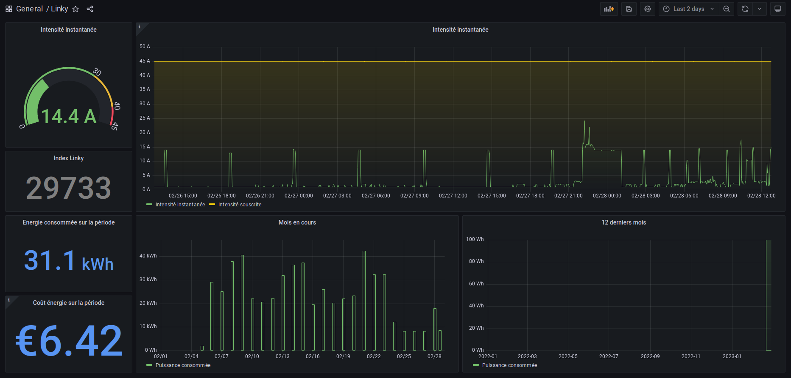
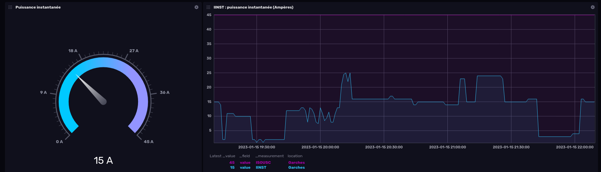

Téléinfo Linky
==============



__Téléinfo Linky__ récupère les données de téléinformation client (TIC) du compteur Linky sur un Raspberry Pi. Les données sont envoyées vers InfluxDB 2.x, vers Prometheus, ou vers les deux. La visualisation peut s'effectuer avec Grafana.

Ce dépôt comprend :
* le programme Python pour lire les données de téléinformation via le port série du Raspberry Pi
* un script d'installation et un service Systemd pour lancer le programme automatiquement
* un tableau de bord Grafana pour InfluxDB et un autre pour Prometheus

Les modifications de chaque version sont décrites dans le [journal des modifications](CHANGELOG.md).


Pré-requis
----------

* Raspberry Pi (ou tout autre système Linux disposant d'un port série)
* Module électronique pour la connexion entre le Linky et le port GPIO du Pi
* Python 3.9 ou plus récent (Raspberry Pi OS 11 ou plus récent)
* InfluxDB 2.x ou Prometheus (avec l'option `--web.enable-remote-write-receiver`), et Grafana (hors cadre de ce tutoriel)

Testé avec un Raspberry Pi Zero W (Raspbian 11) et le module [PITInfo](https://www.tindie.com/products/Hallard/pitinfo/) (~10€)

Je recommande d'utiliser l'UART PL011 via `/dev/ttyAMA0` car le comportement de `/dev/ttyS0` est plus erratique. Voir la section Activation de l'UART PL011 sur Raspberry Pi Zero en bas de page.


Test téléinformation
--------------------

Vérification que l'utilisateur est bien dans le groupe `dialout` pour pouvoir accéder au port série :

    $ groups

Si ce n'est pas le cas, ajout de l'utilisateur au groupe `dialout` (n'oubliez pas le `-a`). Note : vous devez vous déconnecter de votre session puis vous reconnecter pour que les droits prennent effet.

    $ sudo usermod -a -G dialout $USER

Une fois le Rasperry Pi connecté au Linky via le module PITInfo, il est possible de vérifier que la téléinfo est bien reçue sur le port série grâce à `screen`:

Si `screen` n'est pas installé, `sudo apt update && sudo apt install screen`

* TIC mode historique (par défaut)

    $ screen /dev/ttyAMA0 1200,cs7

* TIC mode standard

    $ screen /dev/ttyAMA0 9600,cs7,parenb,-parodd,-cstopb


Vous devez recevoir en boucle des informations qui ressemblent à cela :

```
MOTDETAT 000000 B
ADCO xxxxxxxxxxxxxx :
OPTARIF BASE 0
ISOUSC 45 ?
BASE 028563823 0
PTEC TH.. $
IINST 003 Z
IMAX 090 H
PAPP 00760 .
HHHCA
MTDTAT000000 B
```

Pour quitter `screen`, tapez `ctrl-a + k`.

Si cela ne fonctionne pas, inutile d'aller plus loin et vérifiez votre installation.


Installation automatique
------------------------

Le script [`install.sh`](install.sh) installe la dernière version dans `~/linky`. Il :
* télécharge l'archive de la version et vérifie sa somme de contrôle SHA-256 ;
* installe les paquets Debian `python3-venv`, `python3-yaml` et `python3-serial` si nécessaire ;
* installe le programme et ses autres dépendances dans un environnement virtuel Python (`~/linky/.venv`). Sur un Raspberry Pi Zero, cette étape prend plusieurs minutes ;
* crée `~/linky/config.yml` à partir de l'exemple, sans jamais modifier un fichier existant ;
* ajoute l'utilisateur au groupe `dialout` si nécessaire ;
* installe et active le service Systemd utilisateur `linky`.

Les commandes qui demandent les droits administrateur (`sudo`) sont affichées avant d'être exécutées.

    $ curl -fsSL https://github.com/hleroy/teleinfo-linky/releases/latest/download/install.sh | bash

Pour lire le script avant de l'exécuter :

    $ curl -fsSLO https://github.com/hleroy/teleinfo-linky/releases/latest/download/install.sh
    $ less install.sh
    $ bash install.sh

Editez ensuite `~/linky/config.yml` (voir Configuration), puis démarrez le service :

    $ systemctl --user start linky

Le même script met à jour une installation existante : il conserve `config.yml` et redémarre le service.


Installation manuelle
---------------------

Les étapes ci-dessous font la même chose que le script d'installation, une par une.

Installation des paquets système

    $ sudo apt update && sudo apt upgrade -y
    $ sudo apt install python3-venv python3-yaml python3-serial

Téléchargement de la dernière version et vérification de sa somme de contrôle

    $ cd /tmp
    $ curl -fsSLO https://github.com/hleroy/teleinfo-linky/releases/latest/download/teleinfo-linky.tar.gz
    $ curl -fsSLO https://github.com/hleroy/teleinfo-linky/releases/latest/download/teleinfo-linky.tar.gz.sha256
    $ sha256sum -c teleinfo-linky.tar.gz.sha256

Facultatif : vérification que l'archive a bien été produite par le dépôt GitHub (nécessite l'outil [`gh`](https://cli.github.com/))

    $ gh attestation verify teleinfo-linky.tar.gz --repo hleroy/teleinfo-linky

Extraction dans `~/linky`

    $ mkdir -p ~/linky
    $ tar -xzf teleinfo-linky.tar.gz -C ~/linky --strip-components=1

Installation dans un environnement virtuel Python. L'option `--system-site-packages` lui donne accès aux paquets Debian installés plus haut, déjà compilés : pip n'a ainsi pas à les télécharger ni à les compiler, ce qui est très lent sur un Raspberry Pi Zero. `PYTHONNOUSERSITE=1` écarte les paquets installés par pip dans `~/.local` (version 1.0.0). Retirez `[influxdb]` si vous n'utilisez que Prometheus.

    $ python3 -m venv --system-site-packages ~/linky/.venv
    $ PYTHONNOUSERSITE=1 ~/linky/.venv/bin/pip install "$HOME/linky[influxdb]"

Création du fichier de configuration (voir Configuration)

    $ cp ~/linky/config.example.yml ~/linky/config.yml

Installation du service Systemd

    $ mkdir -p ~/.config/systemd/user
    $ cp ~/linky/linky.service ~/.config/systemd/user/
    $ systemctl --user daemon-reload
    $ systemctl --user start linky

Vérifiez que le service est bien démarré et qu'il n'y a pas d'erreur dans les journaux

    $ systemctl --user status linky
    $ journalctl --user-unit linky

Au démarrage, le journal confirme la lecture des trames et le premier envoi vers chaque destination :

    INFO: Démarrage de Téléinfo Linky 1.2.1
    INFO: InfluxDB : envoi vers https://influxdb.example.com, bucket teleinfo
    INFO: Prometheus : envoi vers https://prometheus.example.com/api/v1/write, toutes les 10 secondes
    INFO: Téléinfo : lecture de /dev/ttyAMA0 en mode historique (1200 Bd)
    INFO: Téléinfo : attente de la première trame...
    INFO: Téléinfo : première trame reçue (ISOUSC, BASE, IINST)
    INFO: InfluxDB : premier envoi réussi
    INFO: Prometheus : premier envoi réussi (7 trames)

Le journal reste ensuite silencieux, sauf en cas d'erreur, et un bilan confirme toutes les 24 heures que le programme fonctionne toujours :

    INFO: Téléinfo : 57 412 trames reçues pendant les dernières 24 heures
    INFO: InfluxDB : 57 412 trames envoyées pendant les dernières 24 heures
    INFO: Prometheus : 57 412 trames envoyées pendant les dernières 24 heures

Puis activez le service (la deuxième commande permet le démarrage automatique des instances utilisateur de systemd)

    $ systemctl --user enable linky
    $ sudo loginctl enable-linger $USER


Mise à jour depuis la version 1.0.0
-----------------------------------

La version 1.0.0 s'installait en copiant `linky.py` dans `~/linky`, avec des dépendances installées par `pip install` pour tout le système. Pour passer à la nouvelle version, lancez le script d'installation automatique ou suivez l'installation manuelle : `config.yml` reste compatible et le service est remplacé. Les dépendances installées par `pip` ne sont plus utilisées (le nouveau service ignore notamment `~/.local`) et peuvent être désinstallées :

    $ pip uninstall PyYAML pySerial influxdb-client

Le fichier `linky.py` est conservé comme lanceur de compatibilité : l'ancien service, qui exécute `/usr/bin/python3 ~/linky/linky.py`, continue de fonctionner tant qu'il n'est pas remplacé.


Configuration
-------------

Le fichier `~/linky/config.yml` contient :
* la section `linky` : nom du lieu (`location`), mode de la TIC (historique ou standard), méthode de calcul de la somme de contrôle et liste des étiquettes à récupérer. Les étiquettes textuelles (`PTEC`, `DEMAIN`, `LTARF`…) sont envoyées sous forme de texte ;
* la section `raspberry` : port série ;
* les sections `influxdb` et `prometheus` : destinations des données. Activez-en une ou les deux avec `send_data: true`. Si aucune n'est activée, le programme lit les trames sans les envoyer, ce qui permet de le tester.

Le programme lit `config.yml` dans le répertoire courant. L'option `--config` permet d'indiquer un autre fichier :

    $ ~/linky/.venv/bin/teleinfo-linky --config /chemin/vers/config.yml


Envoi vers InfluxDB
-------------------

Configurez l'adresse du serveur, le bucket, le jeton (token) et l'organisation dans la section `influxdb`.

Chaque étiquette est une *measurement* (`BASE`, `IINST`...) avec un champ `value` et un tag `location`. Le champ `value` est un entier, ou un texte pour les étiquettes textuelles (`PTEC`, `DEMAIN`…). Si InfluxDB est injoignable, les trames sont conservées en mémoire et renvoyées dès que possible.


Envoi vers Prometheus
---------------------

Le programme envoie les données par *remote write* (`POST /api/v1/write`). Prometheus doit être lancé avec l'option `--web.enable-remote-write-receiver`. Configurez l'adresse complète du point d'entrée dans la section `prometheus`, et éventuellement un identifiant et un mot de passe (authentification Basic, par exemple derrière un reverse proxy). Les trames sont regroupées et envoyées toutes les `push_interval` secondes (10 par défaut), chacune avec son propre horodatage.

Chaque étiquette devient une métrique `linky_<étiquette en minuscules>` avec les labels `job="linky"` et `location`. Les caractères `+` et `-` des étiquettes du mode standard sont remplacés par `_`. Prometheus ne stocke que des nombres : une étiquette textuelle devient une métrique d'information `linky_<étiquette>_info`, de valeur 1, dont le label `value` contient le texte.

| Etiquette      | Métrique                                     |
| :------------- | :------------------------------------------- |
| `BASE`         | `linky_base`                                 |
| `IINST`        | `linky_iinst`                                |
| `ISOUSC`       | `linky_isousc`                               |
| `SMAXSN-1`     | `linky_smaxsn_1`                             |
| `PTEC` (texte) | `linky_ptec_info{value="HP.."}`, de valeur 1 |

Différences avec InfluxDB :
* Prometheus refuse les échantillons de plus d'une heure. Si le serveur reste injoignable plus de 50 minutes, les trames plus anciennes sont abandonnées.
* La durée de conservation des données de Prometheus est souvent courte (15 jours par défaut). Allongez-la (`--storage.tsdb.retention.time`) pour conserver l'historique de consommation.

Si le serveur n'accepte que l'IPv4 alors que le Raspberry Pi dispose d'une adresse IPv6, associez le nom du serveur à son adresse IPv4 dans `/etc/hosts`.


Tableau de bord
---------------

Importez dans Grafana le tableau de bord correspondant à votre base de données : [`dashboard_grafana.json`](dashboard_grafana.json) pour InfluxDB ou [`dashboard_grafana_prometheus.json`](dashboard_grafana_prometheus.json) pour Prometheus.

Pour l'option heures pleines / heures creuses avec InfluxDB, deux autres tableaux de bord sont proposés, contribués par [Heat Miser](https://github.com/Heat-Miser) :
* [`dashboard_grafana_hphc.json`](dashboard_grafana_hphc.json) en mode historique, avec les étiquettes `HCHC`, `HCHP`, `PTEC`, `PAPP`, `IINST` et `ISOUSC` ;
* [`dashboard_grafana_standard_hphc.json`](dashboard_grafana_standard_hphc.json) en mode standard, avec les étiquettes `EAST`, `EASF01` (heures creuses), `EASF02` (heures pleines), `LTARF`, `SINSTS`, `IRMS1`, `URMS1` et `PCOUP`. Avec `EAIT` et `SINSTI`, il affiche aussi l'énergie injectée (production solaire, par exemple). L'affectation des index `EASF01` et `EASF02` dépend du calendrier de votre fournisseur : vérifiez-la sur votre compteur.

Le panneau « Coût énergie sur la période » utilise des prix du kWh inscrits dans sa requête : adaptez-les à votre contrat.

Avec InfluxDB, la configuration d'un tableau de bord directement dans l'interface d'InfluxDB est également assez intuitive :




Diverses notes
--------------

Efface toutes les données dans le bucket teleinfo d'InfluxDB

    $ influx delete --bucket teleinfo --start '1970-01-01T00:00:00Z' --stop $(date +"%Y-%m-%dT%H:%M:%SZ")


Activation de l'UART PL011 sur Raspberry Pi Zero
------------------------------------------------

Le Raspberry Pi Zero W contient deux UART pour la communication série, le mini UART (accessible sur `/dev/ttyS0`) et l'UART PL011 (accessible sur `/dev/ttyAMA0`). Ce dernier est un _vrai_ UART hardware, plus performant que le mini-UART. Par défaut, il est utilisé par le module Bluetooth. Pour l'utiliser pour la communication série, il faut :
* Activer l'UART
* Désactiver le Bluetooth
* Désactiver le port console sur l'interface série

Ajouter à la fin de `/boot/config.txt`

```
# Enable UART
enable_uart=1

# Disable Bluetooth
dtoverlay=disable-bt
```

Editer `/boot/cmdline.txt` et retirer `console=serial0,115200`

Désactiver les services Bluetooth
    $ sudo systemctl disable hciuart
    $ sudo systemctl disable bluetooth.service

Redémarrez.


Copyright et license
====================

Téléinfo Linky est publié sous licence [GNU General Public License v3.0](COPYING) (GPL-3.0-or-later).

Copyright © 2023 - 2026 Hervé Le Roy – hleroy@hleroy.com

This program is free software: you can redistribute it and/or modify
it under the terms of the GNU General Public License as published by
the Free Software Foundation, either version 3 of the License, or
(at your option) any later version.

This program is distributed in the hope that it will be useful,
but WITHOUT ANY WARRANTY; without even the implied warranty of
MERCHANTABILITY or FITNESS FOR A PARTICULAR PURPOSE.  See the
GNU General Public License for more details.

You should have received a copy of the GNU General Public License
along with this program.  If not, see <https://www.gnu.org/licenses/>.
